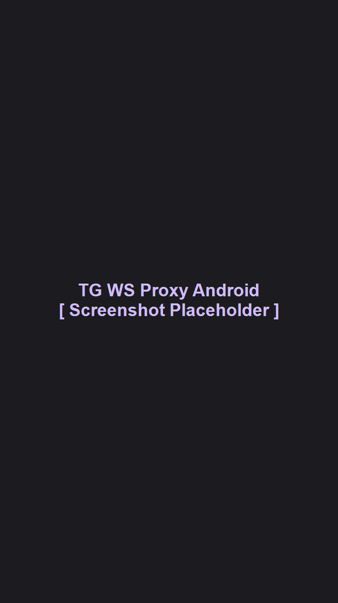

<div align="center">

# TG WS Proxy for Android 🚀

**Нативный MTProto WebSocket-прокси для Telegram на Android**  
*Ускоряет работу Telegram и загрузку медиафайлов, перенаправляя трафик через защищённые WebSocket-соединения.*

[](https://www.android.com/)
[](https://kotlinlang.org/)
[](https://developer.android.com/jetpack/compose)
[](https://opensource.org/licenses/MIT)
[](https://github.com/nickstrlnkv/tg-ws-proxy-android/releases)

<br />

<p align="center">
  
</p>

</div>

---

## 📖 О проекте

**TG WS Proxy for Android** — это автономное, энергоэффективное Android-приложение, реализующее локальный MTProto-прокси-сервер на вашем смартфоне (`127.0.0.1:1443`).

Приложение оптимизирует скорость работы Telegram и передачу медиафайлов (видео, голосовые сообщения, фото, истории) за счёт прямого туннелирования трафика через защищённые WebSocket-шлюзы к дата-центрам Telegram.

### Принцип работы

1. **Локальный порт:** Приложение поднимает локальный TCP-сокет на `127.0.0.1:1443` (MTProto Obfuscation 2.0).
2. **Транспорт через WebSocket (WSS):** Приложение принимает MTProto-пакеты от клиента Telegram и инкапсулирует их в быстрые защищённые WebSocket-потоки по TLS/HTTPS.
3. **Маршрутизация к шлюзам Telegram:** Запросы передаются к официальным шлюзам Telegram (`/apiws`) через распределённую Anycast CDN сеть с балансировкой нагрузки и низкими задержками.
4. **Сквозная безопасность (E2E):** Прокси работает исключительно на транспортном уровне. Все сообщения, медиафайлы и ключи сессий остаются **полностью зашифрованными алгоритмом MTProto от устройства до серверов Telegram**. Прокси не имеет доступа к вашим персональным данным или перепискам.

---

## ✨ Ключевые возможности

- ⚡ **100% Native Kotlin:** Мгновенный отклик, минимальное потребление RAM и батареи, никакого Python или тяжелых рантаймов.
- 🎨 **Material 3 UI:** Чистый, адаптивный интерфейс с поддержкой темной/светлой темы и анимаций.
- 🔋 **Энергоэффективная фоновая работа (`ForegroundService`):** Стабильная работа в фоне при выключенном экране.
- 🔄 **Интеллектуальное авто-переподключение:** Плавное переключение сессий при смене сетей (Wi-Fi ↔ LTE/5G).
- 🌐 **Встроенный балансировщик Anycast-доменов:** Автоматическое распределение нагрузки и высокая отказоустойчивость по пулу из 20 проверенных доменов.
- 📊 **Мониторинг в реальном времени:** Отображение текущей скорости отдачи и загрузки (KB/s, MB/s), общего переданного объёма данных и активных соединений.
- 🔗 **Подключение в 1 нажатие:** Мгновенный импорт конфигурации в Telegram по ссылке `tg://proxy?...`.
- ⚙️ **Гибкая кастомизация:** Возможность смены порта прослушивания, секрета и подключения кастомных Cloudflare Workers.

---

## 🚀 Быстрый старт

### 1. Установка
1. Перейдите в раздел **[Releases](https://github.com/nickstrlnkv/tg-ws-proxy-android/releases)**.
2. Скачайте актуальный APK-файл (`tg-ws-proxy-android.apk`).
3. Установите APK на ваш смартфон (если потребуется, разрешите установку из неизвестных источников для вашего браузера/проводника).

### 2. Запуск и настройка
1. Откройте **TG WS Proxy**.
2. Нажмите кнопку **«Запустить прокси»** (на Android 13+ подтвердите разрешение на отправку уведомлений).
3. Нажмите кнопку **«Подключить в Telegram»**.
4. Telegram автоматически откроется и отобразит диалоговое окно добавления прокси:
   - **Сервер:** `127.0.0.1`
   - **Порт:** `1443`
   - **Секрет:** предустановленный ключ
5. Нажмите **«Включить»** (или «Использовать этот прокси»).

> 💡 В строке состояния Telegram появится значок щита со статусом **«Подключено»**.

---

## 🔧 Часто задаваемые вопросы (FAQ)

<details>
<summary><b>Нужен ли Root-доступ?</b></summary>
Нет, root-права не требуются. Локальный интерфейс (loopback <code>127.0.0.1</code>) на Android полностью открыт для взаимодействия между приложениями без дополнительных привилегий.
</details>

<details>
<summary><b>Безопасно ли это? Передаются ли куда-то мои переписки?</b></summary>
Абсолютно безопасно. В архитектуре MTProto конечное шифрование согласуется исключительно между клиентом Telegram и серверами Telegram. TG WS Proxy является прозрачным ретранслятором: он упаковывает бинарные чанки в WebSocket-фреймы и передает их в шлюз. Никакие пароли, токены, сообщения или метаданные не читаются и никуда не сохраняются.
</details>

<details>
<summary><b>Сильно ли расходуется батарея?</b></summary>
Приложение использует неблокирующий асинхронный сетевой стек (Kotlin Coroutines + OkHttp). В режиме ожидания приложение практически не потребляет процессорное время.
</details>

---

## 🛠 Сборка из исходников

Для самостоятельной сборки потребуется:
- **Android Studio** (Ladybug / Meerkat или новее)
- **JDK 21**
- **Android SDK** (API 35/36)

```bash
# Клонирование репозитория
git clone https://github.com/nickstrlnkv/tg-ws-proxy-android.git
cd tg-ws-proxy-android/android

# Сборка Release APK
./gradlew assembleRelease
```
Собранный файл будет доступен по пути: `android/app/build/outputs/apk/release/app-release.apk`.

---

## 👥 Благодарности и лицензия

- **Автор порта для Android:** [@nickstrlnkv](https://github.com/nickstrlnkv)
- **Оригинальный проект для Desktop:** [Flowseal/tg-ws-proxy](https://github.com/Flowseal/tg-ws-proxy) (автор [@Flowseal](https://github.com/Flowseal))

Проект распространяется под открытой лицензией **MIT License**. Подробнее см. в файле [LICENSE](LICENSE).

---

<div align="center">

*Если проект вам понравился, не забудьте поставить ⭐️ звезду репозиторию!*

</div>
